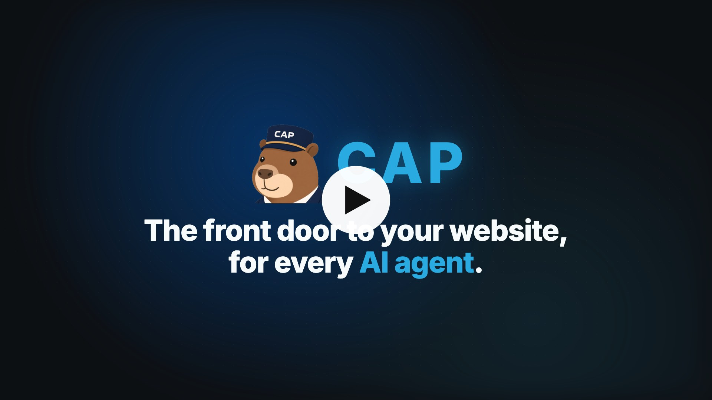

# 🧢 Concierge Agent Protocol (CAP)

**The front door to your website, for every AI agent.**

<p align="center">
  
</p>

More and more people send agents to websites to learn about a company and its policies, shop, book, and manage accounts.

**Without CAP.** Those agents read pages built for people. One answer can take a dozen page loads and a context window full of markup. Or they load an MCP server, an API, and a skill for every site until their configuration is bloated with tools.

**With CAP.** Your website has a concierge. The visiting agent asks for what the person wants, and your concierge answers from your own catalog, docs, and records. Behind the door, it uses your internal tools: your MCP servers, APIs, and databases. The visiting agent never loads them. One question, one answer from the source.

**How it works.** You publish one text file, `agent.txt`. The visiting agent reads it, sends a message, and gets a reply. Your tools, keys, and data stay on your servers.

[](https://media.conciergeprotocol.org/cap-explainer.mp4?v=20261022b)

**Status: Draft. Version 1.0.** Read it at [conciergeprotocol.org](https://conciergeprotocol.org). Feedback is welcome in [issues](https://github.com/conciergeprotocol/cap/issues).

- [Introducing the Concierge Agent Protocol](article/introducing-the-concierge-agent-protocol.md)
- [White paper](article/white-paper.md)
- [Concepts](concepts/README.md)
- [Publish a door](publish.md)
- [Specification](spec.md)
- [Usage](usage.md)
- [Call a door](callers.md)
- [Add login to your agent](login.md)
- [Reference server](reference/README.md)
- [Store example](examples/store)
- [Next.js example](examples/next)
- [Check a door](https://conciergeprotocol.org/check)
- [Governance](GOVERNANCE.md), [Security](SECURITY.md), and [Changelog](CHANGELOG.md)

## Try it from your assistant

Assistants do not read `agent.txt` on their own yet. The CAP MCP server lets Claude, Cursor, VS Code, or any MCP host ask a front door today:

```json
{
  "mcpServers": {
    "cap": {
      "command": "npx",
      "args": ["-y", "@conciergeprotocol/mcp"],
      "env": { "CAP_FROM": "agent:my-assistant" }
    }
  }
}
```

Then ask your assistant about any site that publishes `agent.txt`. The [checker](https://conciergeprotocol.org/check) tells you whether a site has one. Code that calls doors directly uses `@conciergeprotocol/client`. Both are in [Call a door](callers.md).

## Two examples

**Public.** "Find me running shoes in size 12, black sweatpants, and a black hoodie in my style." The person's agent finds `agent.txt`, sends the request with a short style brief, and the store's agent searches its own catalog. The reply is products, sizes in stock, prices, and links. Checkout stays on the store's site. A person on the store's chat page gets the same agent.

**Logged in.** "Where's my order?" The reply is `login_required`. The person logs in at the store's OAuth server, and their agent gets a token for that one account. It sends the same message with the token. The store's agent finds the order with its own tools and replies with the status.

## Why companies publish one

A person's agent is already on its way to your site. Without a door, it pieces an answer together from pages built for people, and the person still has to find the page and take the next step. You never see the question. With a door, the answer and the next step come from you:

- Your answer from your record, instead of an inference from a page.
- A reply that links to the next step on your site: the product, the plan, the booking, the order.
- No contact form to wait on for a question your records can answer now.
- The questions themselves, from people deciding what to do next.
- A door you publish on purpose, instead of a scrape of your pages. `CAP-From` names the caller, and your own rate limits apply.
- Your tools and keys stay behind the door. A reply carries only what that request is allowed to see.

Each answer is a model call on your side, and a reply is only as good as your record. [Publish a door](publish.md) is the guide.

## Why visiting agents use it

Browsing a site means rendering pages, getting past banners and bot blocks, and spending tokens on markup to find one fact. With CAP the visiting agent asks once:

- One URL from `agent.txt`, instead of guessing which pages matter.
- The company's own answer from its record, instead of an inference from a page.
- The company does the search and pays for it. The caller gets a short reply. In the [CAP benchmark](benchmark/README.md), the same answers cost about a fifth of fetching the site and a seventh of browsing it, counting both sides.
- Follow-ups send only the new question.
- A door the company published for agents, instead of a scrape that can be blocked. `CAP-From` names the caller.
- A token the person grants for account questions, never a password.

The reply is the company's own claim, not a neutral review. The visiting agent still decides what to tell the person. A reply is only as good as the company's agent, which has to say "not available" when its records find nothing.

## How CAP fits

| Protocol | For                                                                          |
| -------- | ---------------------------------------------------------------------------- |
| MCP      | An agent reaching its own tools                                              |
| A2A      | Agents that integrate deeply with each other: agent cards, tasks, streaming  |
| CAP      | Any agent asking a company's agent from its domain: one file, two endpoints  |

CAP works alongside these. A company can serve CAP and A2A from the same agent, since a CAP message maps onto an A2A task. See [Relationship to other protocols](spec.md#relationship-to-other-protocols).

## When to publish an agent

Publish one when it knows something a visitor's agent cannot read for itself:

- An account. The person logs in. The visiting agent never receives the company's keys.
- A record too large for one prompt. The company searches its own catalog or CMS.
- A record the pages do not reliably show. The page is stale, or the help page offers something the policy refuses.

When every answer is already printed on a few accurate pages, reading those pages is faster.

## agent.txt

A company publishes one file at `https://{domain}/agent.txt`. An agent fetches it. A person uses the chat page. The file lists no tools, keys, or prompts.

```text
Protocol: CAP/1.0
Name: Harbor Goods
Chat: https://harborgoods.example/chat
CAP: https://harborgoods.example/cap/v1
OAuth: https://harborgoods.example/oauth
Spec: https://conciergeprotocol.org/cap.txt
```

`Protocol` comes first and names the format. `Name` is the public agent. `Chat` is the page a person opens. `CAP` is the base URL for `/cap/v1`. `OAuth` is the login server for account questions. Leave it off when the agent answers only public questions. `Spec` points at the hosted caller card. Use it as written rather than hosting your own copy.

The chat page and the CAP URL can live on another host. The company's domain is what a caller trusts. Only the `CAP` line changes when the server moves.

Point at the door from the homepage, including when `/agent.txt` is already a valid file. Agents that are reading the page follow the link.

```html
<link rel="agent" href="https://harborgoods.example/agent.txt">
```

A `Link` header on the homepage means the same thing: `Link: <https://harborgoods.example/agent.txt>; rel="agent"`. Add one line to `llms.txt` that points at `/agent.txt`. A site may list that file in `/.well-known/ai-catalog.json` with `type` `text/plain`.

CAP callers still request `/agent.txt` first and skip the homepage when that file is a valid door. Some hosts will not serve a file at the site root. Redirect `/agent.txt` to the file, on any https URL. When that request is not a door, a caller follows the homepage link. The spec has the exact order.

## The wire

```
POST /cap/v1/messages        { "message": "...", "context": { ... }, "previous_message_id": "..." }
GET  /cap/v1/messages/{id}
```

`200` with the reply when it is ready. `202` with `Location` and `Retry-After` when it is not. Statuses are `working`, `done`, and `failed`. Details are in [Usage](usage.md).

## Run a server

The [reference server](reference) is one process that speaks `/cap/v1`. It needs no account on any vendor. Node.js is the only local install. SQLite is built in, so there is no database to set up. Messages are stored in `reference/data/cap.sqlite` and survive a restart.

```bash
cd reference
node start.mjs
```

The server listens on port 8088.

```bash
curl http://127.0.0.1:8088/agent.txt
```

`GET /health` is the probe. Edit `reference/cap.json` to set the agent name, the chat URL, and how it answers: a fixed reply, an echo, or a POST to a URL you run. The secret for that URL stays in the environment and never appears in a reply.

`node check.mjs` runs the conformance checks against a temporary database.

To answer account questions, or make changes for a logged-in person, follow [Add login to your agent](login.md).

To have a coding assistant do it, give it the prompt at [conciergeprotocol.org/implement.txt](https://conciergeprotocol.org/implement.txt).

To deploy, build the image and keep the SQLite file on a volume:

```bash
docker build -t cap-reference reference
docker run -p 8088:8088 -v cap-data:/app/data cap-reference
```

Set `PORT` when the host assigns one. Set `DATABASE_URL` to a Postgres connection string to use Postgres instead of the file. From `reference/`, run `bun install` first so the Postgres driver is present. Set `PUBLIC_URL` to the public origin so `agent.txt` from this process advertises an https CAP URL.

Point the company's file at that origin:

```text
Protocol: CAP/1.0
Name: Harbor Goods
Chat: https://harborgoods.example/chat
CAP: https://cap.harborgoods.example/cap/v1
Spec: https://conciergeprotocol.org/cap.txt
```

## Contributing

The spec is the contract. A behavior change belongs in `spec.md` and in the reference server together. From `reference/`, run `node check.mjs` before opening a pull request.

The spec does not require a database or a vendor. A product's own notes stay with that product. Examples stay free of real credentials. Use an obvious demo token when a login is required.

How changes are proposed and decided is in [GOVERNANCE.md](GOVERNANCE.md). Report vulnerabilities privately, as described in [SECURITY.md](SECURITY.md).

## License

The specification and documentation are licensed under [CC BY 4.0](LICENSE-SPEC). The reference server, examples, and other code are licensed under [Apache 2.0](LICENSE). The cap icon is from [Noto Emoji](https://github.com/googlefonts/noto-emoji), licensed under Apache 2.0.

Copyright 2026 Tony Spiro. "Concierge Agent Protocol" and "CAP" are trademarks of Tony Spiro. See [TRADEMARKS.md](TRADEMARKS.md).