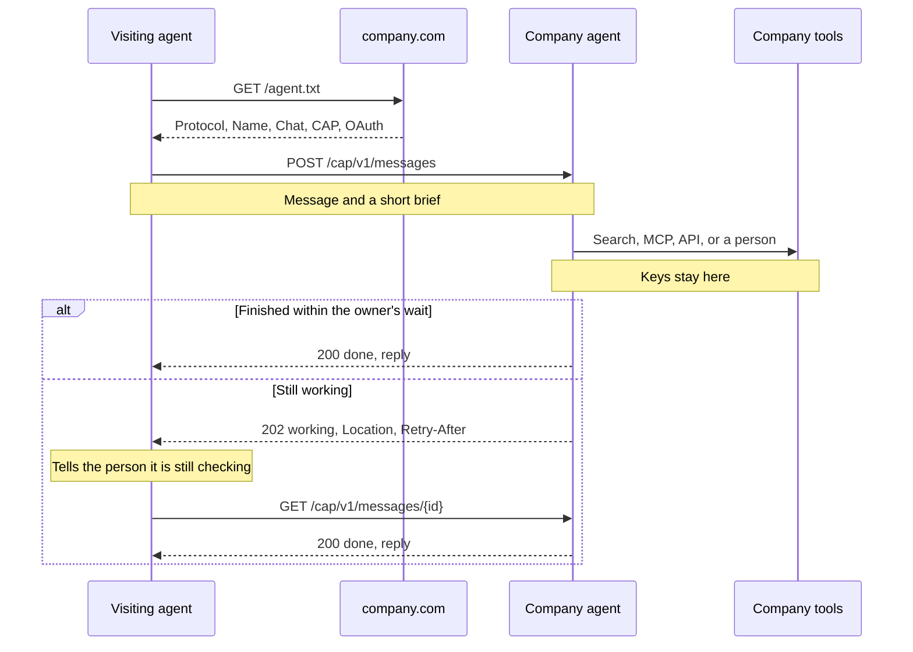

# The Concierge Agent Protocol

**The front door to your website, for every AI agent.** Share results, not credentials.

Draft, October 2026.

## Abstract

A company will greet a person and an agent at the same door, and it has no contract for the agent. The Concierge Agent Protocol is that contract. A visiting agent finds the company's agent from `/agent.txt` on the company domain, sends a message, and gets a reply. The company's tools, MCP servers, and API keys never cross. Questions about an account use an OAuth token the person grants. The wire is two HTTP endpoints under `/cap/v1`. The specification is [spec.md](../spec.md).

## The problem

People ask their own agents to shop, compare, and check on orders. Those agents arrive at company websites built for people.

For a small site with accurate pages, reading the pages works. Three cases break it:

- **The account.** "Where's my order?" is not on a public page. The answer is behind a login.
- **The size of the record.** A catalog of thousands of products does not fit in one prompt. The visitor guesses URLs, and the company's own search goes unused.
- **The page and the record disagree.** A help page offers a refund the policy refuses, or a price changed in the CMS and the page is still old.

The company loses in each case. It never sees the question, so it cannot tell what people wanted or correct a wrong answer. When the visiting agent does find an answer, the person still has to open the site, find the page, and take the next step themselves, and a question the records could answer now can still end in a contact form.

The other route is to integrate with the company's tools: an MCP server or an API. With scoped permissions and proper authentication, both work well for a partner that connects on purpose. They ask a lot of an agent that arrives once with one question: find the server, learn the schema, and get access, for every company it visits. Few companies offer that to the public, so most visiting agents fall back to the pages.

Browsing costs the visiting agent too. It renders JavaScript, clicks past banners, runs into bot blocks and CAPTCHAs, and spends its own tokens reading markup written for people. What it ends up with is an inference from a page, not a statement from the company.

People already handle this with each other. You ask the concierge at the front desk. The concierge works for the company, not for you, and looks it up with the company's own access. If it takes a minute, they tell you so, and you wait. If it is about your account, they ask you to sign in first. CAP is that exchange, for agents.

## One object

A **message** is one question and its answer. The caller sends `message` text and an optional `context` brief. The owner returns an id and a status: `working`, `done`, or `failed`. A `done` message has a `reply`, which is text with any links inline. A `failed` message has an `error` written for the person. `login_required` is the one defined failure code.

The owner answers from the text, the brief, the person's grant, and its own record of the thread, never from anyone else's conversation. A follow-up names the last message with `previous_message_id` and sends only the new text. The owner rebuilds the earlier turns itself, so a caller cannot forge what the owner said.

The owner answers however it chooses: its own MCP servers, semantic search over its CMS, a direct API, or a person. The caller does not learn which.

## Agent to agent



What crosses the boundary: the message, the brief, the status, and the reply. What does not cross: prompts, tool lists, MCP endpoints, transcripts, internal ids, limits, and vendor keys.

## The front door

`https://{domain}/agent.txt` is a text file, the same kind of root file as `robots.txt`. The first line names the format, so a caller does not mistake another file called `agent.txt` for this one.

```text
Protocol: CAP/1.0
Name: Harbor Goods
Chat: https://harborgoods.example/chat
CAP: https://harborgoods.example/cap/v1
OAuth: https://harborgoods.example/oauth
```

`Chat` is the page a person opens. `CAP` is the base URL for the two endpoints. `OAuth` is where a person logs in. One domain has one agent, and a person on the chat page and an agent on the CAP URL reach the same one. The chat page, the CAP URL, and the file may be hosted for the company. The company's domain serves the file, or points at it with a redirect or a homepage link.

## What the company gains

- **Its own answer.** The reply is the company's statement from its record, not a visitor's reading of its pages.
- **A shorter path to the next step.** The reply carries links to the product, plan, booking, or order. The step happens on the company's site, without a crawl, a second search, or a form.
- **Sight of the question.** Each message is a question the company can read, answer better next time, and count.
- **A sanctioned way in.** Agents use the door instead of scraping. `CAP-From` names the caller, as a label rather than verified identity, and the company's rate limits apply.
- **No exposure.** Tools, prompts, keys, and other customers' data stay on the company's side. Account access needs the person's grant.
- **A small install.** One file and two endpoints, served by the agent the company already runs on its chat page.

The company pays for the model call behind each answer and bounds it with its own limits. A door is worth publishing when its agent knows something the pages do not show reliably.

## What the visiting agent gains

- **One place to ask.** `agent.txt` gives one URL. No sitemap walk, no guessing which page matters.
- **The record.** The owner answers from its catalog, policies, and accounts, with its own search. Where the page and the record disagree, the visitor gets the record.
- **Less spend.** The owner does the search and pays for the model call. The caller receives a short reply instead of pages of HTML in its context.
- **Attribution.** The reply is the company's statement. A `working` message has no reply, so the caller has nothing to repeat until there is one.
- **Cheap follow-ups.** The caller sends only the new text with `previous_message_id`.
- **Personalization without a profile.** `context` is a short brief, such as a size and a style. It does not say who the person is.
- **Permission.** The company published the door. Browsing can be blocked. A CAP call uses the way in the company chose. `CAP-From` names the caller, but it is a label, not proof of identity.
- **No passwords.** Account access is a token the person grants. The caller never holds a password or drives a logged-in browser.

The limits are equally plain. The reply is the company's framing, so comparisons and reviews still need other sources. A reply is only as good as the owner's record. A fact already printed on one accurate page can be faster to read than to ask. Until most domains publish `agent.txt`, callers keep browsing as the fallback.

## Logging in

A product question needs no token. An account question without one ends `login_required`. The person logs in at the `OAuth` server and consents. The visiting agent receives a token bound to that account and to itself, and sends it as `Authorization: Bearer`. `CAP-From` names the visiting agent. A token used by a different agent is `403`. Revoking the token stops the agent. The vendor keys never moved.

## Waiting

The owner waits a short time on its own, under 30 seconds. If the reply is ready, it returns `200`. If not, it returns `202` with `Location` and `Retry-After`. The caller waits that long and reads again. It never invents a reply while the message is `working`, and it tells the person the company is still answering.

Limits are the owner's business. When it will not take more from a caller, it returns `429` with `Retry-After`. It does not publish its budget.

## Built from familiar parts

`202` with `Location`, `Retry-After`, `429`, OAuth bearer tokens, `Idempotency-Key`, and the `{ error: { code, message } }` body are all common HTTP practice. `agent.txt` and `CAP-From` are the only new pieces.

The announcement is [Introducing the Concierge Agent Protocol](introducing-the-concierge-agent-protocol.md). How to call the endpoints is [Usage](../usage.md). The [overview](../home.md) has `agent.txt` and how to run a server.
