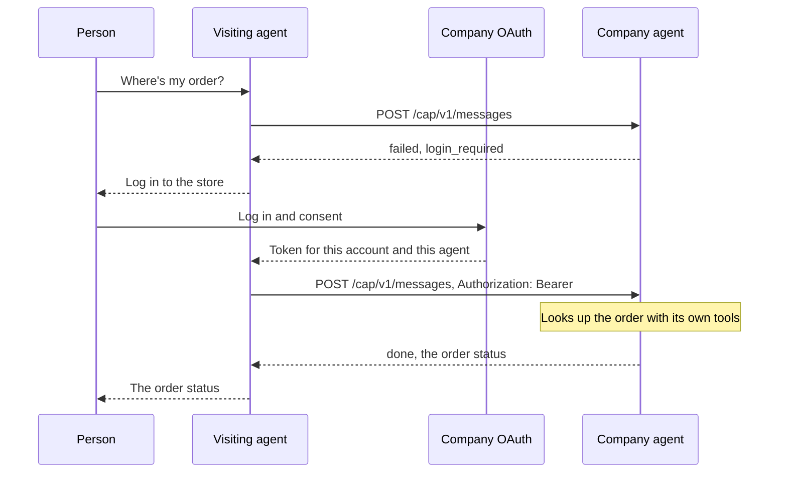

# Access

A public question, such as a product search or store hours, needs no token. A question about a person's account needs that person to log in.

Two identities travel on an account question. `Authorization: Bearer` is the person and the account. `CAP-From` is the visiting agent. The token works only for the agent it was issued to. Another agent with the same token gets `403`.

An account name or number in the brief is not access. Only the token decides whose account the company reads.

The person's password goes to the company's login page, never to their agent. The company's keys never leave the company. Revoking the token stops that agent, and nothing else has to rotate.
