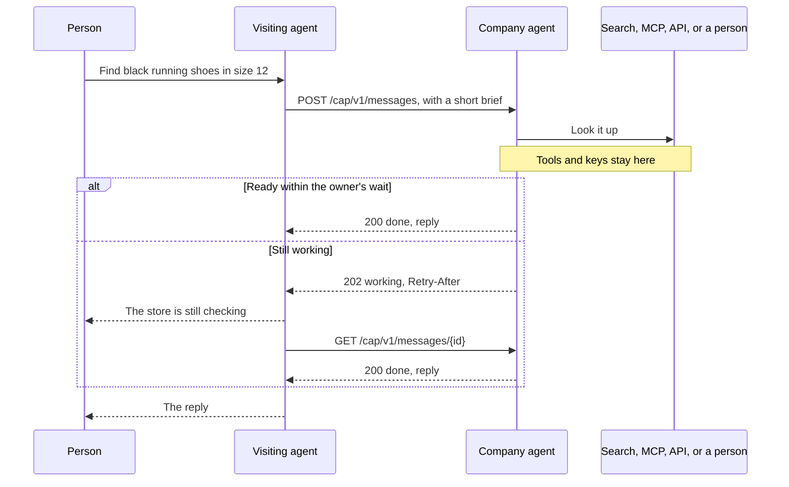

# Messages

A message is one question and its answer. The visiting agent sends text and an optional brief. The company's agent answers with its own tools and returns text.

A message is `working`, `done`, or `failed`. Only `done` has a `reply`. Only `failed` has an `error`. While it is `working`, the visiting agent does not guess. It tells the person and waits for `Retry-After`.

The brief is what the visiting agent knows that the company does not: a size, a style, a date. It is short. It is not the person's profile, and it is not the company's API payload.

A follow-up such as "something cheaper?" sets `previous_message_id` to the last message. The company's agent answers with the whole thread in mind, rebuilt from its own records. The visiting agent sends only the new text, so it cannot rewrite what the company said earlier. A thread can gain a login partway through. It never switches accounts.

The reply is text, with links inline. Checkout, booking, and payment stay on the company's site.
