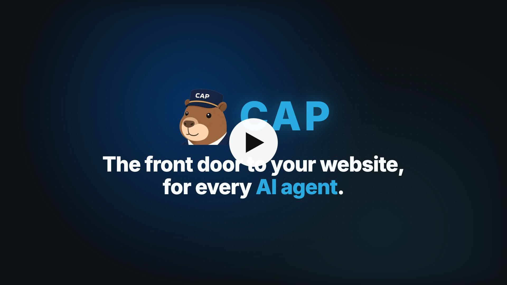

# Concierge Agent Protocol (CAP)

**The front door to your website, for every AI agent.**

Let AI agents ask your business directly. Your agent answers from your catalog, docs, and records, with a link to the product, plan, or booking page on your site. When a person is logged in, their agent can ask about their own account and make the changes they approve.

<a class="cta" href="/publish">Make your website agent-ready</a><a class="cta-alt" href="#see-cap-in-action">See CAP in action</a>

### See CAP in action

The same shopping question, read from the site and asked through CAP. [See the benchmark](benchmark/README.md).

<figure class="bench-replay" data-replay></figure>

Three live doors are on the [demos](/demos) page: a vacation rental, a store, and a company site. CAP does not require Cosmic, or any other vendor.

The stewardship is temporary. When three organizations independent of Cosmic serve CAP in production, or when version 1.0 is final, the specification, the reference code, and the trademarks move to a neutral foundation. [Read the commitment](/governance#foundation).

### Why websites publish a door

<strong>Own your answers</strong>
Agents get your catalog, docs, and policies, not a guess from your pages.

<strong>Link buyers to the right page</strong>
Replies link to the product, plan, or booking page on your site.

<strong>See what they ask</strong>
Every question comes to your agent, so you know what people want.

A person's agent is already on its way to your site. [Cloudflare reports](https://blog.cloudflare.com/agentic-web/) that daily requests from AI agents on its network grew more than 1,700% over the past year, and [Meta said](https://s21.q4cdn.com/399680738/files/content_files/META-Q3-2026-Earnings-Call-Transcript.pdf) on October 21, 2026 that more than 10 million people had set up its Muse agent in about six weeks, with shopping the most common use.

### Start here

You publish one text file, `agent.txt`. A visiting agent reads it, sends a message, and gets a reply. Your tools, keys, and data stay on your servers.

<a href="/publish">Websites<strong>Publish a door</strong>
Give agents your answer, from your content, with a link to buy or book.
</a>
<a href="/callers">AI agents<strong>Call a door</strong>
Ask a company's agent directly, with the client library or the MCP server.
</a>
<a href="/check">Verify<strong>Check a site</strong>
Read its agent.txt, ask one public question, and see what passed.
</a>
<a href="/directory">Live doors<strong>Directory</strong>
Sites whose front door passes the check.
</a>
<a href="/demos">Try one<strong>Demos</strong>
A rental, a store, and a company site, each with a working door.
</a>
<a href="/spec">Contract<strong>Specification</strong>
Messages, access, and the rules a door and a caller both follow.
</a>
<a href="/benchmark">Proof<strong>Benchmark</strong>
The same shopping question, through CAP, fetching, and browsing.
</a>
<a href="/login">Accounts<strong>Add login</strong>
A person's agent can ask about their account and make the changes they approve.
</a>
<a href="/concepts">Model<strong>Concepts</strong>
One message in, one reply out, and the access that shapes it.
</a>

